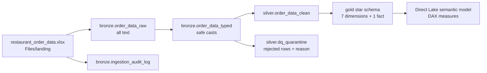

# chowhoundltd_jamer

Restaurant Profile semantic model for **ChowHound, LTD**, built on **Microsoft Fabric**: a medallion pipeline (bronze, silver, gold) in Spark notebooks, a star schema in a Lakehouse, and a Direct Lake semantic model with its DAX measures.

The case: ChowHound supplies ingredients to restaurants and charities. After Covid-19 it cannot always fill orders, and its CEO believes the money lost is small because restaurants reorder the same items within 60 days. Restaurant information sits in several systems and reports, so questions about peers, drivers and growth are hard to answer. This project builds one trusted restaurant profile and tests the CEO's statement against the order data.

> The source workbook and the case brief are **not** included in this repository.

## Contents

| File | Purpose |
|---|---|
| `01_bronze.ipynb` | Ingests the workbook from `Files/landing`, validates the 24-column contract, writes raw (all text) and typed tables, and creates the control tables |
| `02_silver.ipynb` | Standardizes keys, reconciles the two POS conventions, tags `source_system`, and applies the data-quality gate with quarantine |
| `03_gold.ipynb` | Builds the star schema: seven dimensions and one fact |
| `dfg2_bronze-key_standardization.pqt` | Dataflow Gen2 template: a visual, business-readable version of the key-standardization rule (outside the execution chain) |

Each notebook ends with a cell of change notes, layer assumptions and design decisions.

## Architecture



Each notebook depends only on the tables of the layer before it, so a reviewer can start at bronze and run `01`, `02`, `03` in order. Nothing outside the notebooks is needed to execute them.

| Layer | Guarantee |
|---|---|
| Bronze | A faithful all-text copy of the source, a validated column contract and an audit row per run |
| Silver | Standard keys, the two POS conventions reconciled, and a quality gate: every row has all keys and a unique primary key; the rest goes to quarantine with its reason |
| Gold | A star schema whose foreign keys resolve by construction, with no aggregation: DAX does the calculating |

### Tables produced

| Schema | Tables |
|---|---|
| `bronze` | `order_data_raw`, `order_data_typed`, `ingestion_audit_log` |
| `silver` | `order_data_clean`, `dq_quarantine` |
| `gold` | `fact_order_lines`, `dim_date`, `dim_restaurant`, `dim_product`, `dim_warehouse`, `dim_status`, `dim_reason_code`, `dim_movement_type` |
| `control` | `processed_files` (files already loaded), `wm_control` (date watermark for a future database source) |

## Data model

| Table | Grain | Key |
|---|---|---|
| `fact_order_lines` | One row per order line (68,898) | `sk_order_line` |
| `dim_restaurant` | One row per restaurant (6,282) | `sk_restaurant` |
| `dim_product` | One row per product (1,028) | `sk_product` |
| `dim_warehouse` | One row per warehouse (89) | `sk_warehouse` |
| `dim_date` | One row per calendar day, 2021-2024 (1,461) | `sk_date` (yyyymmdd) |
| `dim_status`, `dim_reason_code`, `dim_movement_type` | Small lookup tables (3, 22, 3) | code |

Surrogate keys are a truncated SHA-256 of the standardized business key, so the fact and every dimension compute the same value independently and no fact row can point to a missing dimension row.

**Relationships (nine, many-to-one, single direction):** the fact to `dim_restaurant`, `dim_product`, `dim_warehouse`, `dim_status`, `dim_reason_code` and `dim_movement_type`; the fact to `dim_date` by entry date (active) and by delivery date (inactive); and `dim_restaurant[first_order_date]` to `dim_date` (inactive).

**Design rule:** gold supplies clean data and DAX does the calculating. A derived column stays in gold only when a visual needs it as a slicer, axis or legend (`fulfillment_status`, `source_system`, `client_status`, `restaurant_segment`, geography names).

## Semantic model

A Direct Lake model over the gold tables with 95 DAX measures in a table named `Metrics`, in eleven display folders: params and dates, base, fulfillment, Objective I, operational, time comparison, restaurant profile, peer benchmark, Objective II, forecast and narrative. Highlights:

- **Year over year** is anchored at the data end (year to date against the same window a year earlier), so it does not depend on a date slicer.
- **60-day reorder** is a bounded look-ahead per unfulfilled line, judged only for lines with a full 60-day window.
- **Forecast** is a three-month moving average with a linear trend as a sensitivity.

## How to run it

1. Use a Microsoft Fabric workspace with a capacity and create a Lakehouse. The preview cells in `03_gold` read `lh_chowhoundltd_orders`; use that name or edit those cells.
2. Upload the source workbook to `Files/landing` in the Lakehouse.
3. Import the three notebooks into the workspace and attach the Lakehouse as the default.
4. In `01_bronze`, set the OneLake path inside `read_excel_as_text` to your own values, replacing `<workspace-id>` and `<lakehouse-id>`, and make sure the folder and file name match where you uploaded the workbook:

   ```
   abfss://<workspace-id>@onelake.dfs.fabric.microsoft.com/<lakehouse-id>/Files/<folder>/restaurant_order_data.xlsx
   ```

5. Run `01_bronze`, then `02_silver`, then `03_gold`, each with `LOAD_MODE = "full"` (the first cell of each notebook).
6. Optional: import `dfg2_bronze-key_standardization.pqt` into a Dataflow Gen2 to see the key rule visually.

Run the notebooks one at a time: separate Spark sessions can hit the capacity's concurrency limit.

## Key results

Computed from the source workbook (68,898 order lines after quarantining two rows with no restaurant id).

| Question | Result |
|---|---|
| Most popular product | `3016012`, 63,500 units ordered |
| Clients with the most unfulfilled orders due to insufficient inventory | Accounts `74843000`, `79016870`, `22742000`: $63,398.60 lost |
| Revenue and profit at risk (3x revenue, 67% margin) | $1,821,655.49 revenue and $1,220,509.18 profit a year |
| January to March 2023 | The start of the new POS: 81.6% of all order lines in three months, not organic growth |
| The CEO's statement | Not supported: 14.2% of unfulfilled lines were reordered within 60 days at the same or a higher quantity, and $4.17M of $4.75M lost did not come back |
| Forecast, April to June 2023 | About $12.88M a month (three-month moving average), with low confidence |

## Assumptions and limits

- **Sign convention:** the new POS exports ids and quantities as negative numbers. They are treated as a convention, not reversals, and normalized with `abs()` on ids and quantities only. There is no overlap with legacy rows, amounts are never negative, and fulfillment is 85.6% legacy against 86.7% new.
- **Coverage is not continuous:** 9 restaurants appear in 2021, 1,490 in 2022 and 5,645 in Q1-2023, and only about 860 appear in both systems. Year-over-year comparisons and lost-client counts must be read with that in mind.
- **Restaurant `99999`** is a shared placeholder (1,054 lines from 123 accounts). It stays in every total and is left out of restaurant rankings.
- **Delivery dates** all fall in January to March 2023, even for orders from 2021-2022, so lead time is not computed.
- **Product codes:** there is no product master; the standardized value is assumed to identify the same product in both systems.
- **Dependence on customs clearance** cannot be determined: the source has no field for it.
- **Incremental loading** (a file registry plus upserts in silver and gold) is implemented, and the delivered evidence is the full load. The incremental branch has not been exercised end to end.
- Status, movement and reason descriptions are inferred from behaviour in the data; there is no business dictionary.

## Conventions

- Everything is in English.
- Comments describe what a line or variable is for. Change notes, evidence and decisions live only in the closing cell of each notebook.
- Transformations use native Spark functions (no Python UDFs) so the work stays in the engine.