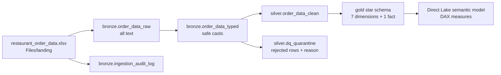
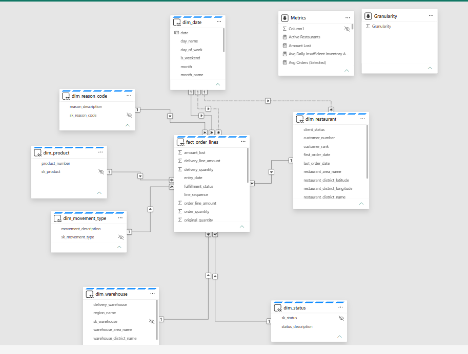

# 🍽️ ChowHound Restaurant Profile: Microsoft Fabric & Power BI

## 📌 At a glance

**💼 Business:** one trusted profile of every restaurant, used to test the CEO's claim that lost orders come back within 60 days. The data says no: only **14.2%** did.

**⚙️ Technical:** a scalable data platform on Microsoft Fabric. Source files land in a Lakehouse (🥉 Bronze), are checked and cleaned with a quality gate that quarantines bad rows (🥈 Silver), and become a star schema feeding a Direct Lake semantic model with 95 DAX measures (🥇 Gold). Loads are incremental and ready for a database source.

**🧰 Environment**


**🚀 Jump to:** [Architecture](#architecture) · [Data model](#data-model) · [Semantic model](#semantic-model) · [Key results](#key-results) · [How to run it](#how-to-run-it)

---

## 🔍 Full detail

Restaurant Profile semantic model for **ChowHound, LTD**, built on **Microsoft Fabric**: a medallion pipeline (bronze, silver, gold) in Spark notebooks, a star schema in a Lakehouse, and a Direct Lake semantic model with its DAX measures.

The case: ChowHound supplies ingredients to restaurants and charities. After Covid-19 it cannot always fill orders, and its CEO believes the money lost is small because restaurants reorder the same items within 60 days. Restaurant information sits in several systems and reports, so questions about peers, drivers and growth are hard to answer. This project builds one trusted restaurant profile and tests the CEO's statement against the order data.

> The source workbook and the case brief are **not** included in this repository.

## Contents

| File | Purpose |
|---|---|
| `01_bronze.ipynb` | Ingests the workbook from `Files/landing`, validates the 24-column contract, writes raw (all text) and typed tables, and creates the control tables |
| `02_silver.ipynb` | Standardizes keys, reconciles the two POS conventions, tags `source_system`, and applies the data-quality gate with quarantine |
| `03_gold.ipynb` | Builds the star schema: seven dimensions and one fact |
| `dfg2_bronze-key_standardization.pqt` | Dataflow Gen2 template: a visual, business-readable version of the key-standardization rule (outside the execution chain) |
| `models/Chow_Hound_Ltd_Report.pbix` | Power BI report, downloadable as a file (see [Downloadable models](#downloadable-models)) |
| `models/semantic_model/` | Definition files of the semantic model: tables, relationships and the 95 DAX measures, downloadable without connecting the repository |

Each notebook ends with a cell of change notes, layer assumptions and design decisions.

## Architecture



Each notebook depends only on the tables of the layer before it, so a reviewer can start at bronze and run `01`, `02`, `03` in order. Nothing outside the notebooks is needed to execute them.

| Layer | Guarantee |
|---|---|
| Bronze | A faithful all-text copy of the source, a validated column contract and an audit row per run |
| Silver | Standard keys, the two POS conventions reconciled, and a quality gate: every row has all keys and a unique primary key; the rest goes to quarantine with its reason |
| Gold | A star schema whose foreign keys resolve by construction, with no aggregation: DAX does the calculating |

### Tables produced

| Schema | Tables |
|---|---|
| `bronze` | `order_data_raw`, `order_data_typed`, `ingestion_audit_log` |
| `silver` | `order_data_clean`, `dq_quarantine` |
| `gold` | `fact_order_lines`, `dim_date`, `dim_restaurant`, `dim_product`, `dim_warehouse`, `dim_status`, `dim_reason_code`, `dim_movement_type` |
| `control` | `processed_files` (files already loaded), `wm_control` (date watermark for a future database source) |

## Data model

| Table | Grain | Key |
|---|---|---|
| `fact_order_lines` | One row per order line (68,898) | `sk_order_line` |
| `dim_restaurant` | One row per restaurant (6,282) | `sk_restaurant` |
| `dim_product` | One row per product (1,028) | `sk_product` |
| `dim_warehouse` | One row per warehouse (89) | `sk_warehouse` |
| `dim_date` | One row per calendar day, 2021-2024 (1,461) | `sk_date` (yyyymmdd) |
| `dim_status`, `dim_reason_code`, `dim_movement_type` | Small lookup tables (3, 22, 3) | code |

Surrogate keys are a truncated SHA-256 of the standardized business key, so the fact and every dimension compute the same value independently and no fact row can point to a missing dimension row.

**Relationships (nine, many-to-one, single direction):** the fact to `dim_restaurant`, `dim_product`, `dim_warehouse`, `dim_status`, `dim_reason_code` and `dim_movement_type`; the fact to `dim_date` by entry date (active) and by delivery date (inactive); and `dim_restaurant[first_order_date]` to `dim_date` (inactive).

**Design rule:** gold supplies clean data and DAX does the calculating. A derived column stays in gold only when a visual needs it as a slicer, axis or legend (`fulfillment_status`, `source_system`, `client_status`, `restaurant_segment`, geography names).

## Semantic model

A Direct Lake model over the gold tables with 95 DAX measures in a table named `Metrics`, in eleven display folders: params and dates, base, fulfillment, Objective I, operational, time comparison, restaurant profile, peer benchmark, Objective II, forecast and narrative. Highlights:

- **Year over year** is anchored at the data end (year to date against the same window a year earlier), so it does not depend on a date slicer.
- **60-day reorder** is a bounded look-ahead per unfulfilled line, judged only for lines with a full 60-day window.
- **Forecast** is a three-month moving average with a linear trend as a sensitivity.

### Model diagram



Model view in Power BI. The striped header marks tables in Direct Lake mode. A solid line is an active relationship and a dotted line is an inactive one: `fact_order_lines` to `dim_date` by delivery date, and `dim_restaurant[first_order_date]` to `dim_date`. `Metrics` and `Granularity` are not related to any table.

### Measures

The definition files are in [`models/semantic_model/`](models/semantic_model/); see [Downloadable models](#downloadable-models).

The measures are in the calculated table `Metrics`. The groups below are for reading this document. Unless a row says otherwise, a measure reacts to the filters in context.

#### Parameters

Some values are measures that return a constant, so they can be changed in one place.

| Measure | Value | What it controls |
|---|---|---|
| `Revenue Multiplier` | 3 | Factor applied to unmet demand to estimate revenue at risk |
| `EBITDA Margin` | 0.67 | Margin applied to projected revenue to estimate profit |
| `Reorder Window Days` | 60 | Days after an unmet line in which a reorder counts |
| `Forecast Fit Months` | 6 | Months used to fit the linear trend of the forecast |

#### Parameters and dates

| Measure | What it returns |
|---|---|
| `Data Start Date` | First `entry_date` in the fact table, ignoring filters |
| `Data End Date` | Last `entry_date` in the fact table, ignoring filters; the anchor of the year-over-year, reorder and forecast measures |
| `Days in Period` | Days between the first and last `entry_date` in the current filter, inclusive |
| `Revenue Multiplier` | Parameter, see [Parameters](#parameters) |
| `EBITDA Margin` | Parameter, see [Parameters](#parameters) |
| `Reorder Window Days` | Parameter, see [Parameters](#parameters) |
| `Forecast Fit Months` | Parameter, see [Parameters](#parameters) |
| `Selected Granularity` | Period chosen in the selector: Weekly, Monthly or Yearly |
| `Selected Period Label` | Text that matches the granularity: "per week", "per month" or "per year" |

#### Base volumes and amounts

| Measure | What it returns |
|---|---|
| `Order Lines` | Count of order lines |
| `Orders` | Distinct count of service order numbers |
| `Order Quantity` | Sum of ordered quantity |
| `Delivered Quantity` | Sum of delivered quantity |
| `Order Amount` | Sum of the ordered amount of the lines |
| `Delivered Amount` | Sum of the delivered amount of the lines |
| `Amount Lost` | Sum of `amount_lost` |
| `Restaurants Ordering` | Distinct count of restaurants with order lines |
| `Total Order Amount` | Same calculation as `Order Amount` |
| `Total Delivery Amount` | Same calculation as `Delivered Amount` |
| `Total Amount Lost` | Same calculation as `Amount Lost` |
| `Delivery Amount by Delivery Date` | `Total Delivery Amount` evaluated by delivery date instead of order date |

#### Fulfillment

A line is fulfilled when the delivered quantity equals the ordered quantity (`fulfillment_status` in gold).

| Measure | What it returns |
|---|---|
| `Fulfilled Lines` | Order lines with status Fulfilled |
| `Not Fulfilled Lines` | Order lines with status Not Fulfilled |
| `Fulfillment Rate` | Fulfilled lines divided by order lines |
| `Quantity Fill Rate` | Delivered quantity divided by ordered quantity |

#### Objective I: insufficient inventory

These measures count only not fulfilled lines with reason code `69-Insufficient Inventory`.

| Measure | What it returns |
|---|---|
| `Insufficient Inventory Lines` | Count of those lines |
| `Insufficient Inventory Amount` | Amount lost on those lines |
| `Insufficient Inventory Rank (Account)` | Rank of each customer account by lines, with the amount as a tie-breaker |
| `Insufficient Inventory Rank (Restaurant)` | Same rank by restaurant; restaurant `99999` is left out |
| `Top 3 Accounts Insufficient Inventory Amount` | Amount lost by the three accounts with the most lines (amount breaks ties) |
| `Top 3 Restaurants Insufficient Inventory Amount` | Same for the top three restaurants; restaurant `99999` is left out |
| `Avg Daily Insufficient Inventory Amount` | Amount divided by `Days in Period` |
| `Projected Annual Unmet Demand` | Daily average times 365 |
| `Projected Annual Revenue` | Projected unmet demand times `Revenue Multiplier` |
| `Projected Annual Profit` | Projected revenue times `EBITDA Margin` |

#### Operational averages

Averages of the measure over the periods that fall in the current filter. Weeks start on Monday (`week_start_date`).

| Measure | What it returns |
|---|---|
| `Avg Sales per Week`, `Avg Sales per Month`, `Avg Sales per Year` | Average `Order Amount` per week, month or year |
| `Avg Orders per Week`, `Avg Orders per Month`, `Avg Orders per Year` | Average `Orders` per week, month or year |
| `Avg Units per Week`, `Avg Units per Month`, `Avg Units per Year` | Average `Order Quantity` per week, month or year |
| `Avg Sales (Selected)`, `Avg Orders (Selected)`, `Avg Units (Selected)` | The same averages for the period in `Selected Granularity` |

#### Time comparison

Year-to-date and prior-year measures are anchored at `Data End Date` and ignore the date filter, so they do not depend on a date slicer. Year to date runs from January 1 of the last year in the data to `Data End Date`. The prior-year window (LFL, like for like) runs from January 1 of the previous year to the same calendar date one year before `Data End Date`.

| Measure | What it returns |
|---|---|
| `Order Amount PM` | `Order Amount` one month earlier than the dates in the filter |
| `Sales Variation % MoM` | Change of `Order Amount` against `Order Amount PM` |
| `Order Amount YTD`, `Order Quantity YTD` | Year-to-date amount and quantity |
| `Order Amount PY LFL`, `Order Quantity PY LFL` | Amount and quantity in the prior-year window |
| `YoY Sales % LFL` | Change of year-to-date amount against the prior-year window |
| `YoY Volume % LFL` | Change of year-to-date quantity against the prior-year window |

#### Restaurant profile

`client_status` is set in `03_gold`: a restaurant is a Lost Client when its last order is more than 90 days before the last date in the data (`LOST_CLIENT_DAYS`).

| Measure | What it returns |
|---|---|
| `Restaurants in Profile` | Count of restaurants in the current filter |
| `Active Restaurants` | Restaurants with status Active Client |
| `Lost Restaurants` | Restaurants with status Lost Client |
| `New Restaurants` | Restaurants whose first order date falls in the filtered dates (uses the inactive `first_order_date` relationship) |
| `Restaurant Age (Days)` | Days from the first order date to `Data End Date` |
| `Avg Restaurant Age (Days)` | Average of the age above across restaurants |
| `Is Decline` | 1 when a restaurant ordered in the prior-year window and its year-to-date quantity is lower, otherwise 0 |
| `Restaurants in Decline` | Sum of `Is Decline` across restaurants |
| `Restaurants with PY Activity` | Restaurants with orders in the prior-year window |
| `Growth Contribution` | Year-to-date amount minus the prior-year window amount |
| `Share of Growth` | `Growth Contribution` divided by the total across the restaurants selected |

#### Rankings

| Measure | What it returns |
|---|---|
| `Restaurant Rank (Order Amount)` | Rank of each restaurant by `Order Amount`; restaurant `99999` is left out |
| `Product Rank (Quantity)` | Rank of each product by `Order Quantity` |

#### Peer benchmark

Peers are the restaurants that share the same `restaurant_area_name`. These measures are meant for one area in context.

| Measure | What it returns |
|---|---|
| `Peer Avg Amount (Area)` | Average `Order Amount` per restaurant in the area |
| `vs Peer Avg %` | Difference between the restaurant's `Order Amount` and that average |
| `Rank in Area` | Rank of the restaurant by `Order Amount` within its area |
| `Restaurants Above Peer Avg` | Restaurants with `Order Amount` above the area average |
| `Restaurants Below Peer Avg` | Restaurants with `Order Amount` at or below the area average |
| `Share Above Peer Avg` | Above divided by above plus below |

#### Objective II: 60-day reorder

Tests the statement that restaurants reorder the same items within 60 days. An unfulfilled line is eligible when its `entry_date` is at least `Reorder Window Days` before `Data End Date`, so only lines with a full window are judged. A line counts as reordered when the same restaurant orders the same product on a later date within the window. "Same or higher" also requires the later order quantity to be at least the quantity of the unfulfilled line. The later line does not need to be fulfilled. The measures do not filter by reason code.

| Measure | What it returns |
|---|---|
| `Unmet Lines (Eligible)` | Not fulfilled lines with a full reorder window |
| `Unmet Amount (Eligible)` | Amount lost on those lines |
| `Reordered Any Lines` | Eligible lines reordered at any quantity |
| `Reordered Same or Higher Lines` | Eligible lines reordered at the same or a higher quantity |
| `Reordered Higher Lines` | Eligible lines reordered at a higher quantity |
| `Reordered Equal Lines` | Same or higher minus higher |
| `Reordered Lower Lines` | Any minus same or higher |
| `Not Reordered Lines` | Eligible lines minus lines reordered at any quantity |
| `Reorder Rate (Same or Higher)` | Reordered same or higher divided by eligible lines |
| `Recovered Amount` | Amount lost on the lines reordered at the same or a higher quantity |
| `Unrecovered Amount` | `Unmet Amount (Eligible)` minus `Recovered Amount` |
| `Recovered Share of Unmet Amount` | `Recovered Amount` divided by `Unmet Amount (Eligible)` |

#### Forecast

Monthly forecast of `Order Amount` for the three months after the month of `Data End Date`. Both methods return a value only for those three months; `Forecast Moving Avg` and `Forecast Linear` are meant for a monthly axis built on `dim_date`.

| Measure | What it returns |
|---|---|
| `MA Base` | Average monthly `Order Amount` of the last three months in the data |
| `Forecast Moving Avg` | `MA Base` for each of the next three months |
| `Forecast Linear` | Linear trend fitted on the last `Forecast Fit Months` months, projected one to three months ahead and never below zero |
| `Forecast Next 3 Months Total (MA)` | `MA Base` times three |
| `Forecast Window Flag` | 1 for months inside the fit window plus the three forecast months, otherwise 0 |

#### Narrative

Text measures that build the headline sentences of the report from other measures.

| Measure | Sentence it builds |
|---|---|
| `Headline Coverage` | Restaurants ordering and order lines |
| `Headline Decline` | Restaurants with prior-year orders that ordered less |
| `Headline Operational` | Average sales, orders and units for the selected period |
| `Headline Objective I` | Amount lost to insufficient inventory and revenue at risk per year |
| `Headline CEO` | Share of unmet lines reordered at the same or a higher quantity within the window |
| `Headline Unrecovered` | Unrecovered amount against the unmet amount |
| `Headline Forecast` | Monthly forecast for the next three months |
| `Headline Peers` | Share of restaurants above their area peers |

#### Conventions used by the measures

- Restaurant `99999` is a shared placeholder. It stays in totals and is left out of restaurant rankings and top-3 measures.
- Year-over-year, reorder and forecast measures use `Data End Date`, not the current date.
- The insufficient-inventory measures match the reason code text `69-Insufficient Inventory`.
- Calculations that depend on the source data (sign convention, coverage by period, delivery dates) are described in [Assumptions and limits](#assumptions-and-limits).

## Downloadable models

This project was developed in a Fabric workspace connected to this repository through Git. When Fabric syncs with Git it **serializes** each item into text-based definition files and **deserializes** them to rebuild the item when changes come back. For that reason the semantic model and the report appear in a serialized form (definition files and metadata), not as the files you open in Power BI Desktop, and they look different from what you see in the workspace.

A format difference is not a damaged model: it is the same item written in a source-control friendly form.

So that the models can be used **without connecting the repository to a workspace**, the folder `models/` holds copies in their direct formats that can be downloaded and consumed:

| Path | What it is | How to use it |
|---|---|---|
| `models/01_bronze.ipynb`, `models/02_silver.ipynb`, `models/03_gold.ipynb` | The three medallion notebooks, with the cell outputs saved from the run in Fabric | Import them into your own Fabric workspace and run them as described in [How to run it](#how-to-run-it) |
| `models/dfg2_bronze-key_standardization.pqt` | The Dataflow Gen2 template | Import it into a Dataflow Gen2 and point its source to your own Lakehouse |
| `models/Chow_Hound_Ltd_Report.pbix` | The Power BI report: four pages (Business Description, Objective I, Objective II and forecast, Client VS) | Download it and open it in Power BI Desktop |
| `models/semantic_model/` | The semantic model definition: gold tables, nine relationships and the 95 DAX measures | Download the folder and load it into your own workspace or Power BI Desktop project; its Direct Lake source points to the original Lakehouse, so point it to your own |

The copies are the items themselves, not the workspace around them. They do not carry the run history and monitoring logs that Fabric keeps for the workspace, the Lakehouse tables (including `bronze.ingestion_audit_log`) or the source workbook, which is not in this repository either. What can be rerun from them: the medallion notebooks and the dataflow, in your own workspace.

> **Note on data access:** the report is a thin file that connects live to the semantic model published in the Fabric workspace. The `.pbix` does not contain the model or the data, so opening it shows data only for people with access to that workspace. The semantic model definition is the portable copy. To rebuild the data behind it, run the three notebooks as described in [How to run it](#how-to-run-it).

## How to run it

1. Use a Microsoft Fabric workspace with a capacity and create a Lakehouse. The preview cells in `03_gold` read `lh_chowhoundltd_orders`; use that name or edit those cells.
2. Upload the source workbook to `Files/landing` in the Lakehouse.
3. Import the three notebooks into the workspace and attach the Lakehouse as the default.
4. In `01_bronze`, set the OneLake path inside `read_excel_as_text` to your own values, replacing `<workspace-id>` and `<lakehouse-id>`, and make sure the folder and file name match where you uploaded the workbook:

   ```
   abfss://<workspace-id>@onelake.dfs.fabric.microsoft.com/<lakehouse-id>/Files/<folder>/restaurant_order_data.xlsx
   ```

5. Run `01_bronze`, then `02_silver`, then `03_gold`, each with `LOAD_MODE = "full"` (the first cell of each notebook).
6. Optional: import `dfg2_bronze-key_standardization.pqt` into a Dataflow Gen2 to see the key rule visually.

Run the notebooks one at a time: separate Spark sessions can hit the capacity's concurrency limit.

## Key results

Computed from the source workbook (68,898 order lines after quarantining two rows with no restaurant id).

| Question | Result |
|---|---|
| Most popular product | `3016012`, 63,500 units ordered |
| Clients with the most unfulfilled orders due to insufficient inventory | Accounts `74843000`, `79016870`, `22742000`: $63,398.60 lost |
| Revenue and profit at risk (3x revenue, 67% margin) | $1,821,655.49 revenue and $1,220,509.18 profit a year |
| January to March 2023 | The start of the new POS: 81.6% of all order lines in three months, not organic growth |
| The CEO's statement | Not supported: 14.2% of unfulfilled lines were reordered within 60 days at the same or a higher quantity, and $4.17M of $4.75M lost did not come back |
| Forecast, April to June 2023 | About $12.88M a month (three-month moving average), with low confidence |

## Assumptions and limits

- **Sign convention:** the new POS exports ids and quantities as negative numbers. They are treated as a convention, not reversals, and normalized with `abs()` on ids and quantities only. There is no overlap with legacy rows, amounts are never negative, and fulfillment is 85.6% legacy against 86.7% new.
- **Coverage is not continuous:** 9 restaurants appear in 2021, 1,490 in 2022 and 5,645 in Q1-2023, and only about 860 appear in both systems. Year-over-year comparisons and lost-client counts must be read with that in mind.
- **Restaurant `99999`** is a shared placeholder (1,054 lines from 123 accounts). It stays in every total and is left out of restaurant rankings.
- **Delivery dates** all fall in January to March 2023, even for orders from 2021-2022, so lead time is not computed.
- **Product codes:** there is no product master; the standardized value is assumed to identify the same product in both systems.
- **Dependence on customs clearance** cannot be determined: the source has no field for it.
- **Incremental loading** (a file registry plus upserts in silver and gold) is implemented, and the delivered evidence is the full load. The incremental branch has not been exercised end to end.
- Status, movement and reason descriptions are inferred from behaviour in the data; there is no business dictionary.

## Conventions

- Everything is in English.
- Comments describe what a line or variable is for. Change notes, evidence and decisions live only in the closing cell of each notebook.
- Transformations use native Spark functions (no Python UDFs) so the work stays in the engine.